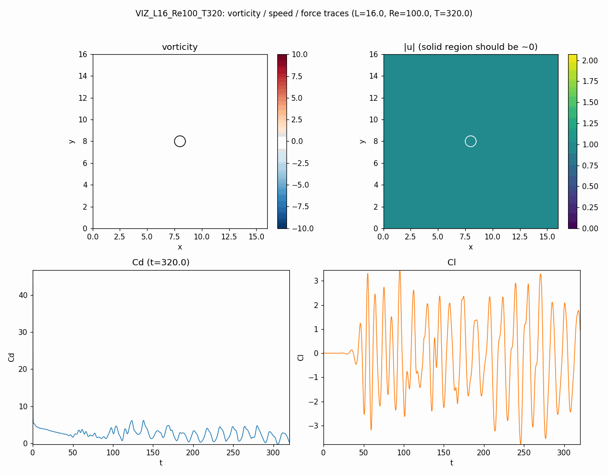
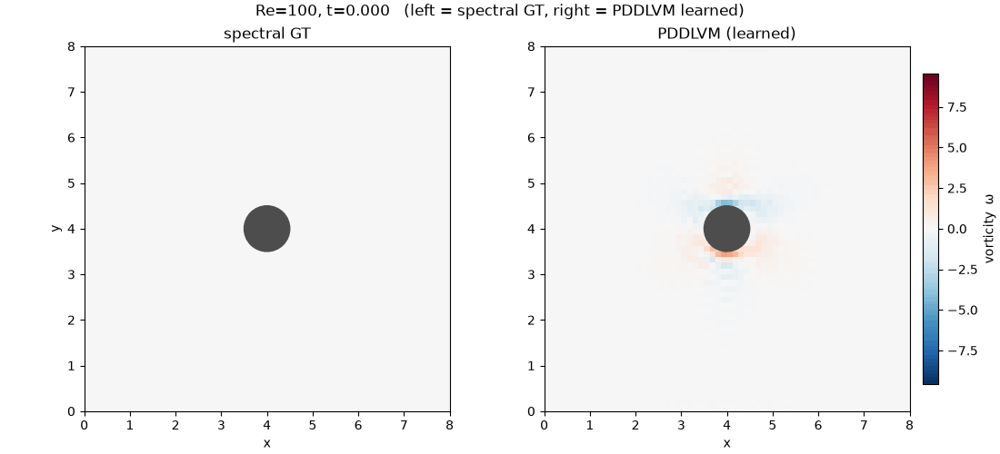

# PDDLVM

[English](README.md) · [中文](README.zh.md)

物理驱动的深度潜变量模型（Physics-Driven Deep Latent Variable Models, PDDLVM），
用于 PDE 反问题：Burgers、Navier–Stokes 与 Swift–Hohenberg 方程。

PDDLVM 把 PDE 正演求解器嵌入分层潜变量模型：潜参数（传导率、源项、边界条件）
经物理过程生成解场，摊还变分后验（amortized variational posterior）从观测反推
潜参数。原始论文见 `reference/PDDLVMPaper/paper_arxiv.tex`，原始代码见
`reference/PDDLVM-main/`。

> 本包按独立测试的分层结构组织（数值层 numerics、概率层 probabilistic、
> 实验层 experiment）。完整概览见 `docs/ENGINEERING.zh.md`。

## 目录结构

```
pddlvm/                 核心包（numerics、probabilistic、networks、VE 模型）
  tests/                单元测试
apps/                   演示脚本（Burgers / NS / Swift-Hohenberg / heat / cylinder）
docs/                   ENGINEERING.md / ENGINEERING.zh.md — 包概览
reference/              原始论文源码（tex）与原始代码
```

## 安装

训练环境是一个固定的 conda 环境：

```bash
conda env create -f environment.yml
conda activate pddlvm2
pip install -e .
```

开发工具（pytest、ruff、mypy）可通过 dev extra 安装，或克隆固定环境后添加：

```bash
conda create -n pddlvm2-dev --clone pddlvm2
conda activate pddlvm2-dev
pip install pytest ruff mypy
pip install -e ".[dev]"
```

> Apple Silicon 说明：这里使用的 TensorFlow 构建来自 conda 频道
> （`tensorflow-macos` / `tensorflow-metal`）；从 PyPI 直接安装 `tensorflow`
> 没有 arm64 wheel。

## 快速开始

运行单元测试：

```bash
python -m unittest discover -s pddlvm/tests -v
```

运行演示（交互式绘图；`--show` 弹出窗口，否则保存到 `artifacts/`）：

```bash
python apps/heat3d_pddlvm.py --quick   # 3D 热方程 PDDLVM（GIF + png）
python apps/burgers_pddlvm.py
```

> 演示必须在 `pddlvm2` 环境下运行（TensorFlow 未装到系统全局）。从仓库根目录
> `python apps/foo.py` 可直接运行（apps 会引导 import 路径），但官方支持的安装
> 方式是 `pip install -e .`。

## 演示

圆柱绕流涡街（伪谱求解器，Re = 100）：



圆柱 PDDLVM — 数据同化（观测 → 全场重建）：学习场 vs 真值涡量：



## 开发

```bash
ruff check .          # 代码风格检查
mypy pddlvm           # 类型检查
pytest                # 测试
python tools/coverage.py   # 离线行覆盖率估算
```

## API 文档

零依赖文档生成（标准库 pydoc）：

```bash
python tools/build_docs.py   # 写入 docs/api/*.html
```

## Docker

```bash
docker build -t pddlvm:2.0.0 .
docker run --rm -v "$PWD/artifacts:/work/artifacts" \
    pddlvm:2.0.0 python run.py configs/ve_prior_default.json --steps 200
```

## 发布说明

见 `CHANGELOG.md`；包概览见 `docs/ENGINEERING.zh.md`。

## 许可证

MIT — 见 `LICENSE`。
